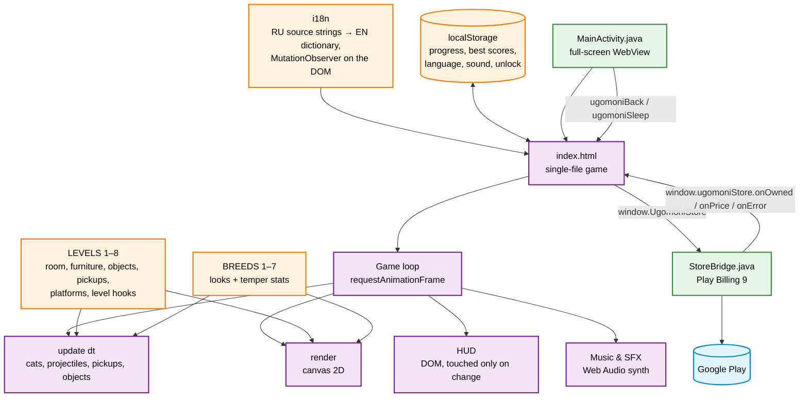
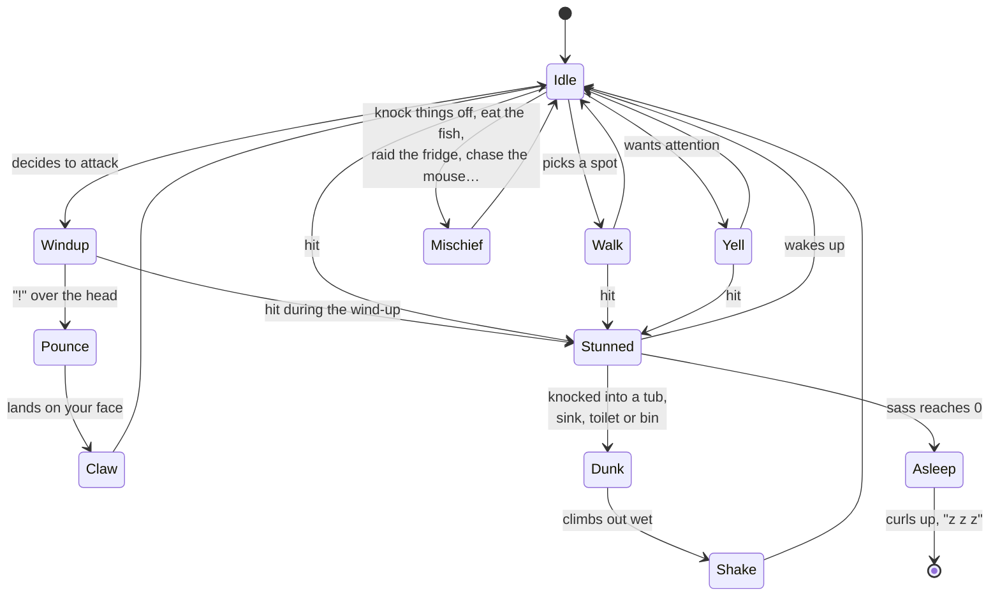
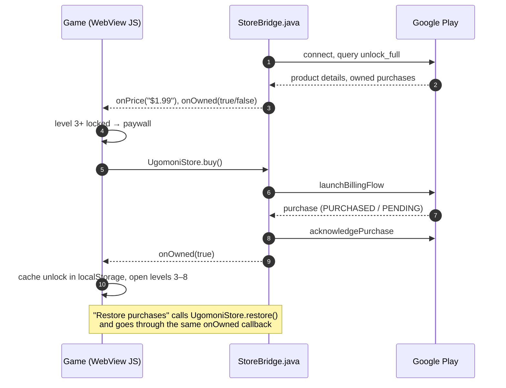

# Hush the Cat · Угомони кота


A cartoon arcade game in the spirit of Moorhuhn about very rude house cats.
It is 3 a.m., you have work in the morning, and the cat has decided it is time to
yell. Throw slippers, pillows and anything else within reach, dodge the claws and
get the cat to sleep before the alarm goes off.

The whole game is **one HTML file**: canvas 2D graphics drawn from code (no image
assets), sound synthesized with Web Audio, eight levels, seven cats and a final
scene. The same file runs in a browser and, wrapped in a WebView, as an Android
app on Google Play with a one-time purchase that unlocks the full game.


<table>
<tr>
<td></td>
<td></td>
</tr>
<tr>
<td></td>
<td></td>
</tr>
</table>

## Architecture



The browser version has no build step and no dependencies: open `index.html` and
play. In a browser every level is open. The Android project in
[`android-play/`](android-play/) bundles the same file (plus fonts) into a WebView
and adds a JavaScript bridge to Google Play Billing; there levels 1–2 are free and
the purchase `unlock_full` opens levels 3–8.

## One frame

```mermaid
graph LR
    BG[Static background<br/>pre-rendered once per level] --> Glass[Window glass,<br/>cracks, things flying out]
    Glass --> Dyn[Level layer<br/>animated props: car, birds, mower…]
    Dyn --> Obj[Objects<br/>vase, lamp, TV…]
    Obj --> Picks[Pickups<br/>cached bitmaps]
    Picks --> Cats[Cats<br/>per-cat cached bitmap,<br/>redrawn every 2nd frame]
    Cats --> FG[Static foreground]
    FG --> FX[Particles, popups,<br/>claw slashes]

    classDef cached fill:#e8f5e9,stroke:#388e3c,stroke-width:2px,color:#000;
    classDef live fill:#fff3e0,stroke:#f57c00,stroke-width:2px,color:#000;
    class BG,FG,Picks,Cats cached;
    class Glass,Dyn,Obj,FX live;
```



Everything is drawn from code at the screen's real pixel density (up to 2×). The
room background and foreground are painted once per level into off-screen canvases.
Resting pickups and the cats are cached as bitmaps placed on whole device pixels, so
busy levels (the yard has seven cats and dozens of items) stay smooth on phones
without losing sharpness. Cats are drawn directly only for poses that leave their
usual box: a pounce at the screen, a dunk into a tub, being sucked into a hood.

## The cat



Each hit lowers the cat's **sass** (its health bar). Sass regenerates while the cat
is up, so you have to keep the pressure on. While the cat is stunned you can collect
your ammo back; reaching for it next to an alert cat gets you scratched. When sass
reaches zero the cat curls up and falls asleep; the level is won when every cat in
the room is asleep. You lose if the alarm rings (the sleep bar runs out), if you run
out of health, or if you run out of things to throw.

## Google Play purchase



There is no server: the purchase state comes from Google Play every time the app
starts, and `localStorage` only keeps it for offline launches. An unacknowledged
purchase would be refunded by Play after three days, so the bridge acknowledges it
right away.

## Levels

| # | Room | Cats | What's special |
|---|---|---|---|
| 1 | Bedroom, 3 a.m. | 1 | Half-open window that swallows misses; wardrobe, desk and shelf break and drop supplies |
| 2 | Bathroom | 1 | Knock the cat into a full tub, sink or toilet; a broken toilet floods the floor |
| 3 | Kitchen | 1 | Fish on the board heals the cat; fridge and freezer doors, stove and range hood are switches |
| 4 | Attic at night | 1 | Garlic and onion braids, skis and a lantern fall on the cat; a bat can carry it out of the window |
| 5 | Living room | 2 | Sofa cushions to throw, chandelier, TV, a table that tips over, a robot vacuum |
| 6 | Kids' room | 1 | Bunk bed, lego traps, a wind-up mouse the cat chases, a basketball hoop bonus |
| 7 | Garage | 2 | Minivan with a very touchy alarm, fuse box that kills the lights, rolling tyres |
| 8 | Yard | 7 | Birds that drop supplies, a lawn mower, an RC car, folding chairs, an apple tree |

After the yard comes a final scene with the reconciled cats and the total score.

## Cats

| Cat | Breed | Temper |
|---|---|---|
| Orange | Ginger street cat | Shares one brain cell with every ginger cat in the world; today isn't his turn |
| Siren | Siamese | Louder than the alarm clock, and she knows it |
| Lucifer | Black cat | Chases invisible demons at 3 a.m.; eyes like saucers |
| Bigfoot | Maine Coon | Huge, fluffy and heavy; scratches hardest of all |
| Turbo | Bengal | Runs on batteries that never die |
| Dobby | Sphynx | Warm, wrinkly and very vengeful |
| Baron Bunsworth | British Shorthair | Slow but impenetrable; demands breakfast with dignity |

Every cat has its own build, coat, eyes, speed, regeneration, aggression and
loudness. The cat you choose in the menu plays the single-cat levels; levels 5 and 7
add a second cat, and the yard brings all seven.

## Controls

| Action | Mouse / touch | Keyboard |
|---|---|---|
| Throw / pick up | click or tap the room | — |
| Choose ammo | left column of slots | 1–7 |
| Heal | right column of slots | H |
| Pause | pause button | P / Esc |

Things fly in an arc, so aim with a little lead. A hit to the head deals ×1.5
damage, and consecutive hits build a combo multiplier. Damage to the room is billed
in roubles and subtracted from the score.

## Repository layout

```
README.md
index.html                 — the whole game (browser version, all levels open)
docs/
  privacy.html             — privacy policy (EN + RU), served by GitHub Pages
android-play/              — Android Studio project for Google Play (AAB + Play Billing)
  PUBLISHING.md            — step-by-step publishing checklist (RU)
  app/build.gradle.kts     — versionCode / versionName, SDK levels, dependencies
  app/src/main/
    AndroidManifest.xml
    assets/index.html      — copy of the game prepared by tools/prepare_assets.py
    assets/fonts/          — bundled fonts so the app works offline
    java/com/alexandercbgm/ugomonikota/
      MainActivity.java    — full-screen WebView, back button, pause on lock screen
      StoreBridge.java     — Play Billing ⇄ JavaScript bridge for unlock_full
    res/                   — launcher icons, app name (EN/RU), theme
  tools/prepare_assets.py  — copies index.html into assets with the Google Fonts bundled
  store/                   — Play listing: texts, icon, feature graphics, screenshots
  keystore.properties.example
android/                   — legacy one-script APK build (no Gradle, no purchases)
dist/
  hush-the-cat-vNN.aab     — latest signed bundle for Google Play
  ugomoni-kota.apk         — old test APK without purchases
```

## Running and building

**Browser.** Open `index.html`. Nothing to install or build.

**Google Play bundle.**

```bash
python3 android-play/tools/prepare_assets.py     # index.html + fonts → app assets
cd android-play
./gradlew bundleRelease                          # → app/build/outputs/bundle/release/app-release.aab
```

Needs JDK 17+ and the Android SDK (`ANDROID_HOME`). Signing uses
`android-play/keystore.properties` and the upload key it points to; both are kept
out of git (see `keystore.properties.example`). Bump `versionCode` in
`app/build.gradle.kts` for every upload: Play rejects a code it has already seen.

The full publishing checklist (developer account, closed testing with 12 testers for
14 days, the in-app product, store listing, content rating) is in
[`android-play/PUBLISHING.md`](android-play/PUBLISHING.md).

## Privacy

The game collects nothing: no ads, no analytics, no accounts, no network calls
apart from Google Play Billing in the Android build. Progress lives in the device's
`localStorage`. Policy:
[alexandercbgm.github.io/hush_the_cat/privacy.html](https://alexandercbgm.github.io/hush_the_cat/privacy.html).
